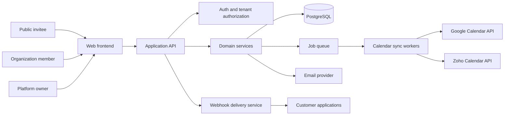

# System Architecture

**Product:** Unified Scheduler  
**Owner:** CTO  
**Status:** Proposed baseline — approve stack and provider details before implementation  
**Version:** 1.0  
**Last updated:** 2026-10-31

## 1. Architecture principles

1. The browser is a presentation and interaction layer. It collects input, displays server state, and calls APIs.
2. The backend is authoritative for availability, booking rules, permissions, validation, tenant boundaries, and provider writes.
3. A booking link defines two separate calendar sets: **calendars to check** and **one destination calendar to write to**.
4. All organization-owned data is tenant-scoped. Every query and mutation must enforce `organization_id` from the authenticated context, not from a trusted client-supplied value.
5. Provider integrations are adapters behind a common calendar-provider interface.
6. External provider calls are asynchronous where possible and protected by idempotency, retries, timeouts, and reconciliation.

## 2. Proposed technology baseline

The following is a proposed baseline, not a claim that infrastructure has already been provisioned:

| Layer | Proposed choice | Responsibility |
|---|---|---|
| Web application | Next.js + React + TypeScript | Workspace UI, public booking pages, Owner Console |
| UI system | Tailwind CSS + shadcn/ui, customized using `design.md` tokens | Accessible reusable UI |
| API | Node.js + TypeScript service (Next.js route handlers initially or separate service) | Authenticated API and business operations |
| Database | PostgreSQL | Tenants, users, bookings, links, calendar metadata, audit records |
| ORM / migrations | Prisma or Drizzle (CTO decision) | Typed persistence and migrations |
| Cache / locks / jobs | Redis-compatible service + durable queue | Short-lived locks, throttling, jobs, retries |
| Authentication | Secure server-side session system | Identity, sessions, organization membership |
| Calendar providers | Google Calendar API and Zoho Calendar API | External calendar reads and writes |
| Email | Transactional email provider (TBD) | Invitations, confirmations, reminders |
| Observability | Structured logs, metrics, error reporting | Operations and diagnostics |

Do not introduce a second database, queue, ORM, or frontend state framework without an approved task plan and architecture update.

## 3. System context and request flow



### Core modules

- Identity and access: accounts, sessions, invitations, organization memberships, roles, approval workflow.
- Organizations: tenant profile, plan, policy, membership.
- Calendar connections: OAuth lifecycle, encrypted credentials, provider accounts, calendar discovery.
- Calendar sync: provider notifications, polling/reconciliation, normalized busy intervals, sync health.
- Availability: working hours, date overrides, buffers, selected calendars, candidate slot generation, conflict checks.
- Booking links: public configuration, publishing, slug uniqueness, host and calendar selection.
- Booking engine: slot holds/locks, confirmation, destination event creation, rescheduling, cancellation.
- Notifications: email templates, reminders, delivery status.
- Developer platform: API keys, scopes, webhooks, delivery attempts, usage limits.
- Platform administration: access requests, organizations, users, plan assignment, audit and health views.

## 4. Responsibility boundaries

### Frontend

- Render pages and components from API data.
- Collect form input and perform lightweight field-format feedback only.
- Maintain transient UI state: open dialogs, selected tab, visible calendar filters, date-picker selection.
- Call the shared API client and display loading, empty, success, and error states.
- Never calculate authoritative availability, decide permissions, merge busy intervals, confirm a booking, or write provider events.

### Backend layers

Every resource follows this flow:

1. **Route:** maps HTTP method/path to a controller and middleware only.
2. **Controller:** parses validated request context, calls a service, returns the standard response. No business calculations.
3. **Service:** owns business rules, authorization decisions, availability calculations, transaction boundaries, and provider orchestration.
4. **Repository:** database queries only; no business rules.
5. **Schema:** request and response validation.

Provider adapters translate common calendar operations to provider-specific APIs. They do not own booking policy.

## 5. Repository structure

```text
unified-scheduler/
├── CLAUDE.md
├── README.md
├── .env.example
├── .gitignore
├── docs/
│   ├── prd.md
│   ├── architecture.md
│   ├── rules.md
│   ├── design.md
│   ├── task.md
│   └── memory.md
├── frontend/
│   └── src/
│       ├── app/
│       │   ├── (auth)/
│       │   ├── (workspace)/
│       │   ├── platform-admin/
│       │   └── book/[slug]/
│       ├── components/ui/
│       ├── components/features/
│       ├── hooks/
│       ├── lib/api/
│       ├── store/
│       └── styles/
│           ├── tokens.css
│           └── global.css
├── backend/
│   └── src/
│       ├── routes/
│       │   ├── auth/
│       │   ├── organizations/
│       │   ├── memberships/
│       │   ├── calendar-connections/
│       │   ├── calendars/
│       │   ├── availability/
│       │   ├── booking-links/
│       │   ├── bookings/
│       │   ├── notifications/
│       │   ├── api-keys/
│       │   ├── webhooks/
│       │   └── platform-admin/
│       ├── providers/calendars/
│       │   ├── calendar-provider.interface.ts
│       │   ├── google/
│       │   └── zoho/
│       ├── middleware/
│       ├── models/
│       ├── config/
│       ├── lib/
│       ├── jobs/
│       └── migrations/
├── packages/
│   ├── shared-types/
│   └── validation/
└── .github/
    ├── workflows/ci.yml
    ├── pull_request_template.md
    └── CODEOWNERS
```

A monorepo is the proposed structure. It can be simplified during implementation, but module boundaries and the six docs must remain.

## 6. Core data model

All IDs should be opaque UUIDs (or another approved non-sequential identifier). All tenant-owned records carry `organization_id` directly or through a rigorously enforced parent relation.

### Identity and tenancy

- `users`: `id`, `email`, `email_verified_at`, `name`, `avatar_url`, `status`, timestamps.
- `organizations`: `id`, `name`, `slug`, `status`, `timezone`, `plan_id`, timestamps.
- `organization_memberships`: `id`, `organization_id`, `user_id`, `role`, `status`, `invited_by`, timestamps. Unique `(organization_id, user_id)`.
- `access_requests`: `id`, `user_id`, `requested_org_id` nullable, `requested_org_name` nullable, `request_type`, `status`, `reviewed_by`, `reviewed_at`, `review_reason`, timestamps.
- `invitations`: `id`, `organization_id`, `email`, `role`, `token_hash`, `expires_at`, `accepted_at`, `invited_by`.
- `sessions`: `id`, `user_id`, `session_hash`, `expires_at`, metadata.

### Calendar connections

- `calendar_connections`: `id`, `organization_id`, `user_id`, `provider` (`google` | `zoho`), `provider_account_id`, `account_email`, `status`, encrypted access/refresh token references, token expiry, granted scopes, last_sync_at, last_error_code, timestamps.
- `calendars`: `id`, `organization_id`, `connection_id`, `provider_calendar_id`, `name`, `timezone`, `is_primary`, `is_readable`, `is_writable`, `sync_status`, timestamps. Unique `(connection_id, provider_calendar_id)`.
- `calendar_selections`: `id`, `booking_link_id`, `calendar_id`, `selection_type` (`conflict_check` | `destination`). Enforce exactly one destination per published link.
- `busy_intervals`: `id`, `organization_id`, `calendar_id`, `provider_event_id`, `start_at_utc`, `end_at_utc`, `status`, `source_updated_at`, `synced_at`. Store only minimum data required for availability where possible; do not persist full private event details by default.
- `calendar_sync_cursors`: provider-specific cursor/delta token and reconciliation state.

### Scheduling

- `host_profiles`: `id`, `organization_id`, `user_id`, `display_name`, `timezone`, `slug`, `default_location`, timestamps.
- `working_hours`: `id`, `organization_id`, `host_profile_id`, `weekday`, `start_local_time`, `end_local_time`, `timezone`, `is_enabled`.
- `availability_overrides`: `id`, `organization_id`, `host_profile_id`, `start_at_utc`, `end_at_utc`, `type` (`available` | `unavailable`), `label`.
- `booking_links`: `id`, `organization_id`, `owner_user_id`, `host_profile_id`, `slug`, `title`, `description`, `duration_minutes`, `buffer_before_minutes`, `buffer_after_minutes`, `minimum_notice_minutes`, `booking_horizon_days`, `status`, `location_type`, `location_value`, `settings_json`, timestamps. Unique public slug within the intended global or tenant namespace; final namespace decision must be documented.
- `booking_questions`: `id`, `booking_link_id`, `label`, `field_type`, `is_required`, `sort_order`, `options_json`.
- `availability_locks`: `id`, `organization_id`, `host_profile_id`, `start_at_utc`, `end_at_utc`, `idempotency_key`, `expires_at`, `status`. Backed by a transaction/locking strategy; not a substitute for provider recheck.
- `bookings`: `id`, `organization_id`, `booking_link_id`, `host_user_id`, `invitee_name`, `invitee_email`, `invitee_timezone`, `start_at_utc`, `end_at_utc`, `status`, `destination_calendar_id`, `provider_event_id`, `manage_token_hash`, `idempotency_key`, `confirmed_at`, timestamps.
- `booking_answers`: `id`, `booking_id`, `question_id`, `answer_value` with sensitive-data minimization and retention controls.

### Platform and developer

- `api_keys`: `id`, `organization_id`, `name`, `key_prefix`, `secret_hash`, `scopes`, `last_used_at`, `expires_at`, `revoked_at`, `created_by`.
- `webhook_endpoints`: `id`, `organization_id`, `url`, `secret_hash`, `subscribed_events`, `status`, timestamps.
- `webhook_deliveries`: `id`, `endpoint_id`, `event_id`, `attempt_count`, `next_attempt_at`, `response_code`, `status`, timestamps.
- `audit_logs`: `id`, `organization_id` nullable for platform actions, `actor_user_id`, `action`, `resource_type`, `resource_id`, `metadata_redacted`, `created_at`.
- `plans`: `id`, `name`, `limits_json`, `features_json`, `status`.

## 7. Availability engine contract

### Inputs

- Host profile and timezone.
- Booking link duration and buffer settings.
- Host working hours and date overrides.
- Booking horizon and minimum notice.
- Selected conflict-check calendars and their sync freshness.
- Existing confirmed bookings and active short-lived locks.
- Requested date range and invitee timezone.

### Processing

1. Validate the public booking link is published and the host is active.
2. Load the host's selected conflict-check calendars and verify each is usable.
3. Fetch fresh busy intervals from local normalized data; refresh provider data when freshness policy requires it.
4. Normalize all intervals to UTC and merge overlapping or adjacent busy intervals.
5. Add existing platform bookings and active locks.
6. Generate candidate slots from host working hours and date overrides.
7. Apply duration, before/after buffers, minimum notice, booking horizon, and timezone conversion.
8. Remove every candidate overlapping any merged busy interval.
9. Return slots with timezone-aware ISO timestamps and display labels.

### Confirmation

1. Validate invitee input and idempotency key.
2. Acquire an atomic lock for host and requested interval.
3. Re-fetch/recheck relevant provider calendars and platform bookings.
4. If a conflict exists, release lock and return `409 SLOT_NO_LONGER_AVAILABLE` with refreshed alternatives.
5. Create a pending booking record.
6. Create event in the one configured destination calendar.
7. On successful provider write, mark booking confirmed and persist provider event ID.
8. On failure, retry safely where appropriate; otherwise mark booking `calendar_write_failed` or `pending_retry`, notify the user clearly, and release/retain the slot according to the explicit recovery policy. Never silently show confirmed when no event exists.
9. Release lock and emit booking event/webhook.

### Provider freshness

Provider push notifications are hints, not the sole source of truth. Maintain scheduled reconciliation and recheck at confirmation. Define provider-specific freshness windows after API quota and latency tests.

## 8. Calendar provider interface

```ts
interface CalendarProvider {
  getAuthorizationUrl(input: OAuthStartInput): Promise<OAuthStartResult>;
  exchangeAuthorizationCode(input: OAuthCallbackInput): Promise<CredentialSet>;
  refreshCredentials(input: CredentialSet): Promise<CredentialSet>;
  listAccounts(input: CredentialSet): Promise<ProviderAccount[]>;
  listCalendars(input: CredentialSet): Promise<ProviderCalendar[]>;
  listBusyIntervals(input: BusyQuery): Promise<BusyInterval[]>;
  createEvent(input: CreateEventInput): Promise<CreatedProviderEvent>;
  updateEvent(input: UpdateEventInput): Promise<UpdatedProviderEvent>;
  deleteEvent(input: DeleteEventInput): Promise<void>;
  revokeCredentials(input: CredentialSet): Promise<void>;
}
```

This is a conceptual contract. Implement only operations supported by the provider API and document provider-specific limitations. Do not assume Google and Zoho offer identical webhook, free/busy, or event semantics.

## 9. API route map

All routes use `/api/v1`. Authenticated workspace routes derive tenant context from the session. API-key routes derive tenant context from the validated key. Public booking routes are rate-limited and scoped by an opaque public slug/token.

| Method and route | Auth | Purpose |
|---|---|---|
| `POST /auth/register` | Public | Register user and create pending access request |
| `POST /auth/login` | Public | Sign in |
| `POST /auth/logout` | Session | End session |
| `GET /me` | Session | Current user and memberships |
| `GET /organizations` | Session | List memberships/workspaces |
| `POST /organizations` | Session | Request/create organization subject to approval |
| `GET /organizations/:orgId/members` | Org role | List members, paginated |
| `POST /organizations/:orgId/invitations` | Owner/Admin | Invite member |
| `GET /calendar-connections` | Session + org | List own connected accounts |
| `POST /calendar-connections/:provider/oauth` | Session + org | Start provider OAuth |
| `GET /calendar-connections/:provider/callback` | OAuth state | Complete OAuth callback |
| `DELETE /calendar-connections/:id` | Connection owner/Admin policy | Disconnect provider account |
| `GET /calendars` | Session + org | List available calendars |
| `PATCH /calendars/:id/selection` | Calendar owner | Configure conflict-check inclusion |
| `GET /availability` | Public or session | Return server-computed slots for a link/host |
| `GET /booking-links` | Session + org | List booking links, paginated |
| `POST /booking-links` | Authorized host/Admin | Create draft link |
| `GET /booking-links/:id` | Authorized member | Read link configuration |
| `PATCH /booking-links/:id` | Owner/authorized host | Update link |
| `POST /booking-links/:id/publish` | Owner/authorized host | Publish link |
| `POST /booking-links/:id/pause` | Owner/authorized host | Pause link |
| `GET /public/booking-links/:slug` | Public | Public-safe link details |
| `GET /public/booking-links/:slug/availability` | Public | Public slots |
| `POST /public/booking-links/:slug/bookings` | Public | Create booking with idempotency key |
| `GET /bookings` | Session + org | List bookings, paginated and filtered |
| `GET /bookings/:id` | Authorized member | Booking detail |
| `POST /bookings/:id/reschedule` | Manage token or authorized member | Reschedule booking |
| `POST /bookings/:id/cancel` | Manage token or authorized member | Cancel booking |
| `GET /platform/access-requests` | Super Admin | List pending requests |
| `POST /platform/access-requests/:id/approve` | Super Admin | Approve request |
| `POST /platform/access-requests/:id/reject` | Super Admin | Reject request |
| `GET /platform/organizations` | Super Admin | List organizations |
| `GET /platform/users` | Super Admin | List users |
| `GET /platform/audit-logs` | Super Admin | Platform audit log |
| `POST /developer/api-keys` | Org Owner/Admin | Create scoped key |
| `DELETE /developer/api-keys/:id` | Org Owner/Admin | Revoke key |
| `POST /developer/webhooks` | Org Owner/Admin | Create webhook endpoint |
| `GET /developer/webhook-deliveries` | Org Owner/Admin | List delivery attempts |

All request and response schemas must be documented in code and OpenAPI. Do not ship undocumented routes.

### Standard response

Success:

```json
{
  "data": {},
  "meta": { "requestId": "opaque-request-id" }
}
```

Error:

```json
{
  "error": {
    "code": "SLOT_NO_LONGER_AVAILABLE",
    "message": "That time is no longer available. Please choose another slot.",
    "details": {}
  },
  "meta": { "requestId": "opaque-request-id" }
}
```

Do not expose stack traces, provider tokens, private event details, or internal database errors.

## 10. Authentication and authorization flow

- Verify email before activating normal workspace access.
- New accounts remain pending until approved under the selected onboarding policy.
- Use secure, HTTP-only, SameSite cookies for browser sessions; rotate session identifiers after authentication and privilege changes.
- OAuth state and PKCE (where supported) protect provider authorization callbacks.
- Encrypt provider refresh/access tokens using a managed encryption key; never store raw tokens in client-accessible tables or logs.
- Every API request resolves the authenticated user, active organization membership, and role server-side.
- Platform Super Admin is a separate platform-level role, not an organization role.
- Support actions that touch customer data must be permissioned, reasoned, time-limited where practical, and audit logged.
- Public booking management uses random high-entropy tokens; persist only token hashes.

## 11. State management

- **Server state:** bookings, availability, calendar connections, members, booking links, analytics. Fetch through the shared API client and a query/cache layer (React Query/TanStack Query proposed).
- **UI state:** selected calendar filters, open panels, current view, temporary builder step, unsaved local form state. Keep local to the relevant feature where possible.
- Never treat cached availability as authoritative at confirmation.

## 12. Error flow

Database/provider → repository/provider adapter → domain service (typed error) → central error handler → standard API response → shared frontend API client → contextual UI message and recovery action.

Provider-specific error codes should be mapped to stable internal codes. Retain correlation IDs across background jobs and webhook deliveries.

## 13. Performance and load plan

- Paginate bookings, members, audit logs, API keys, and organization lists.
- Index `(organization_id, start_at_utc, end_at_utc)` for bookings and busy intervals, plus lookup indexes for slugs, connection IDs, and provider event IDs.
- Avoid one provider API call per calendar row; batch where provider APIs support it.
- Cache public link configuration briefly; never cache a final booking decision as authoritative.
- Use bounded date windows for availability queries.
- Set and measure API-call budgets per screen before release.
- Use background jobs for sync, reminders, webhook delivery, and reconciliation.

## 14. Rendering and SEO

- Public booking link details: server-rendered where feasible for fast first paint and social metadata; no invitee-specific information in metadata.
- Public availability: fetched from API after link page loads or server-side with short cache rules; do not index time-slot responses.
- Authenticated workspace and Owner Console: authenticated app rendering; noindex.
- Booking confirmation, reschedule, cancellation and tokenized management pages: noindex and no sensitive data in shared metadata.

## 15. Environments and configuration

- `development`: local provider OAuth test apps and synthetic calendar data.
- `staging`: isolated database, provider apps/test accounts, noindex, test email sink.
- `production`: approved OAuth apps, production secrets, backups, monitoring, verified domain.

All configuration is typed and read from environment/secret manager. `.env.example` lists names and descriptions only. No real credentials in Git.

## 16. Operational safeguards

- Daily database backups and tested restore procedure.
- Calendar sync dead-letter queue and retry visibility.
- Alert on provider token refresh failures, sustained sync lag, booking write failures, queue backlog, and API error spikes.
- Audit all role, approval, API-key, connection, and booking state changes.
- Define data retention, account deletion, organization deletion, and provider token revocation workflows before production.
