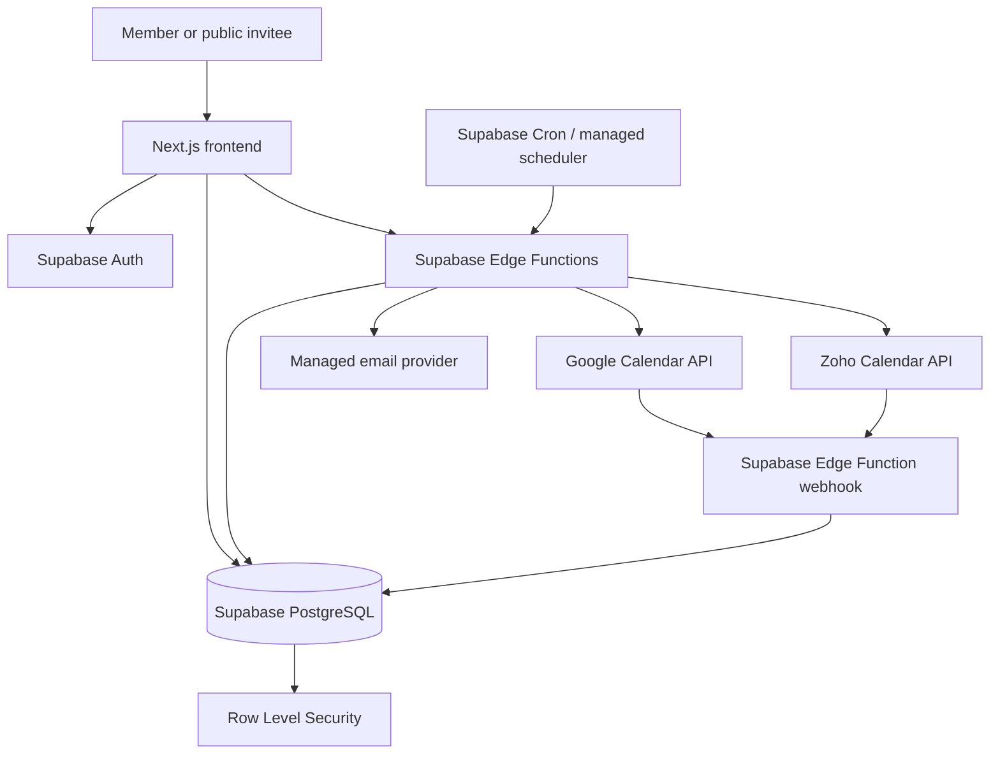

# System Architecture — Frontend + Managed Services

**Product:** Unified Scheduler  
**Architecture decision:** Frontend-first application using Supabase managed services  
**Status:** Approved direction for implementation planning; verify provider capabilities before enabling production OAuth  
**Version:** 2.0  
**Last updated:** 2026-10-31

## 1. Architecture decision

Build one browser-first application. Do **not** create or maintain a separate Node.js/Express/NestJS backend, custom API server, custom database server, Redis cluster, or job-worker service.

Use:
- **Next.js + React + TypeScript** for the application and UI.
- **Supabase** for managed authentication, PostgreSQL database, Row Level Security (RLS), Storage if needed, Realtime where useful, and Edge Functions.
- **Supabase Edge Functions** only for operations that must execute in a trusted environment: OAuth callbacks/token exchange, provider API calls requiring secrets, booking confirmation, calendar writes, webhook handling, and privileged workflows.
- **Google Calendar API** and **Zoho Calendar API** as external calendar providers.
- A managed transactional email provider, selected later, for invitations and booking notifications.

Edge Functions are small serverless functions deployed to Supabase. They are not a separately operated backend application. Keep them focused; do not recreate a large custom API server inside them.

## 2. Responsibility map

| Capability | Where it lives |
|---|---|
| Screens, navigation, forms, calendar UI | Next.js frontend |
| Authentication, sessions, password reset | Supabase Auth |
| Tenant data and relational records | Supabase PostgreSQL |
| Tenant row access | PostgreSQL RLS policies |
| Simple authenticated CRUD | Supabase client + RLS |
| OAuth authorization-code exchange and refresh tokens | Supabase Edge Functions |
| Provider credentials and other secrets | Supabase project secrets / secure server-side storage; never browser env vars |
| Google/Zoho API calls | Supabase Edge Functions |
| Authoritative availability calculation | Edge Function using authorized database/provider data |
| Atomic booking confirmation and collision prevention | PostgreSQL transaction/RPC with constraints/locking, invoked through a trusted Edge Function |
| Calendar event create/update/delete | Edge Function |
| Provider webhooks | Edge Function endpoint |
| Email delivery | Edge Function calls selected email provider |
| Scheduled reminders/reconciliation | Supabase Cron invoking Edge Functions, or an approved managed scheduler |
| Platform and organization administration UI | Next.js frontend; data access governed by RLS and trusted functions |

Do not put service-role keys, OAuth client secrets, refresh tokens, webhook signing secrets, or provider credentials in browser code, `NEXT_PUBLIC_*` variables, local storage, or client-readable tables.

## 3. Proposed technology baseline

| Layer | Choice | Notes |
|---|---|---|
| Web | Next.js, React, TypeScript | App Router; confirm repository conventions first |
| Styling/components | Tailwind CSS + shadcn/ui, customized to `design.md` | Do not introduce a second design system |
| Auth | Supabase Auth | Email verification; OAuth/social login only if approved |
| Database | Supabase PostgreSQL | SQL migrations committed to repository |
| Authorization | PostgreSQL RLS + narrowly scoped Edge Functions | RLS is mandatory for tenant-owned tables |
| Serverless trusted operations | Supabase Edge Functions (Deno runtime) | No standalone API service |
| Database functions | PostgreSQL functions/RPC | Only for atomic database operations; keep readable and tested |
| Calendar providers | Google Calendar API, Zoho Calendar API | Verify scopes, regions, quotas, and webhook support first |
| Scheduling | Supabase Cron or managed scheduler | Avoid a self-hosted worker/queue |
| Email | Managed transactional email provider (TBD) | Select after requirements/cost review |
| Monitoring | Supabase logs/metrics + frontend error monitoring (TBD) | Never log secrets or private event details |

This is the selected implementation direction, not a claim that Supabase or provider projects are already provisioned. Confirm Supabase plan limits, Edge Function limits, OAuth verification requirements, and provider API behavior before production launch.

## 4. High-level request flow



## 5. Application structure

Use a single frontend application with Supabase configuration, SQL migrations, and Edge Functions alongside it. Adjust paths to the actual repository rather than moving existing code unnecessarily.

```text
unified-scheduler/
├── CLAUDE.md
├── README.md
├── .env.example
├── docs/
│   ├── prd.md
│   ├── architecture.md
│   ├── rules.md
│   ├── design.md
│   ├── task.md
│   ├── memory.md
│   └── implementation.md
├── src/
│   ├── app/
│   │   ├── (auth)/
│   │   ├── (workspace)/
│   │   ├── platform-admin/
│   │   └── book/[slug]/
│   ├── components/
│   │   ├── ui/
│   │   └── features/
│   ├── hooks/
│   ├── lib/
│   │   ├── supabase/       # browser and server-safe Supabase clients
│   │   ├── auth/
│   │   ├── calendar/
│   │   ├── validation/
│   │   └── utils/
│   ├── types/
│   └── styles/
├── supabase/
│   ├── config.toml
│   ├── migrations/
│   ├── functions/
│   │   ├── google-oauth-start/
│   │   ├── google-oauth-callback/
│   │   ├── zoho-oauth-start/
│   │   ├── zoho-oauth-callback/
│   │   ├── calendar-list/
│   │   ├── calendar-busy/
│   │   ├── booking-slots/
│   │   ├── booking-confirm/
│   │   ├── booking-reschedule/
│   │   ├── booking-cancel/
│   │   ├── provider-webhook-google/
│   │   ├── provider-webhook-zoho/
│   │   └── send-notification/
│   └── seed.sql
├── tests/
│   ├── unit/
│   ├── integration/
│   └── e2e/
└── .github/workflows/
```

Only create functions when a use case requires trusted execution. Function names above are a planning inventory, not a requirement to create empty functions up front. Prefer a small number of well-scoped functions over a large function per button.

## 6. Data model and tenancy

Use Supabase Auth `auth.users` as the identity source. Keep application profile and tenant data in public-schema tables with RLS enabled.

Core tables (final columns and constraints must be captured in migrations):

- `profiles`: user profile fields keyed to `auth.users.id`.
- `organizations`: tenant/workspace details, slug, timezone, status, plan.
- `organization_memberships`: organization/user/role/status; unique `(organization_id, user_id)`.
- `access_requests`: requests to create or join an organization, approval status and reviewer metadata.
- `invitations`: organization, email, role, hashed invitation token, expiry and acceptance state.
- `calendar_connections`: organization, owner user, provider, provider account metadata, status and token reference/secure credential fields.
- `calendars`: connected provider calendars, read/write capability, timezone and sync status.
- `booking_links`: owner, host, slug, duration, buffers, notice, horizon, status and public configuration.
- `booking_link_calendars`: booking link, calendar, selection type (`conflict_check` or `destination`). Enforce exactly one destination for a published link using a safe database design/transactional validation.
- `working_hours` and `availability_overrides`: host schedules and exceptions.
- `busy_intervals`: minimum necessary busy data; avoid copying private event titles/descriptions by default.
- `bookings`: invitee details, slot, timezone, status, destination calendar, provider event reference and idempotency key.
- `booking_audit_events`: status changes and actor/action metadata.
- `api_keys`, `webhook_endpoints`, `webhook_deliveries`: later-phase developer platform records; store only hashed API-key secrets.

### RLS and tenant isolation

- Enable RLS on every table exposed through the Supabase Data API.
- Policies must derive access from `auth.uid()` and verified membership rows, never from a client-supplied organization ID alone.
- Use helper SQL functions only when they are `SECURITY INVOKER` by default and their permissions are carefully tested. Any `SECURITY DEFINER` function requires explicit review, fixed `search_path`, least privilege, and tests.
- Public booking pages must expose only the published booking-link configuration and computed available slots. Do not expose organization membership, calendar IDs, provider tokens, or private event details.
- Supabase service-role credentials bypass RLS. Use them only inside trusted Edge Functions and only for the minimum operation; never send them to the browser.
- Platform-owner access must not imply permission to inspect private calendar event content.

## 7. Calendar provider integration

Implement a small provider adapter module within Edge Functions (or shared Deno-compatible code) so Google and Zoho differences do not leak into booking rules.

Normalized operations:

- Start OAuth and validate callback state.
- Exchange authorization code and refresh credentials.
- List provider accounts/calendars and inspect read/write permissions.
- Read free/busy or the minimum event data needed for conflict checks.
- Create, update, and delete an event in the chosen destination calendar.
- Handle provider webhook notifications where supported.
- Reconcile changes with a scheduled sync when webhook delivery is unavailable or insufficient.

Provider credentials must never be returned to the frontend. OAuth state must be unpredictable, short-lived, single-use, and bound to the initiating user/workspace. Verify Google and Zoho scopes, callback requirements, Zoho data-center/region behavior, API quotas, event-write behavior, and notification support before implementation.

## 8. Availability and booking invariants

1. A booking link has one or more calendars selected for conflict checking and exactly one destination calendar.
2. A candidate slot is blocked if **any** selected conflict-check calendar is busy during the slot plus configured buffers.
3. Availability is calculated in the trusted Edge Function/database layer, not solely in browser JavaScript.
4. The browser may display returned slots, but cannot authoritatively declare a slot available.
5. Booking confirmation must recheck conflicts immediately before committing.
6. Use a database transaction, row/advisory lock or equivalent concurrency-safe mechanism, plus idempotency and uniqueness constraints where appropriate, to prevent two simultaneous confirmations from claiming the same host/slot.
7. Create the external provider event only in the selected destination calendar. Never copy events to every connected calendar.
8. Do not show `confirmed` until the destination provider write has succeeded and the booking record is safely committed. If a provider timeout leaves the write outcome unknown, reconcile before retrying to avoid duplicate events.
9. Store UTC timestamps and the relevant IANA timezone; handle daylight-saving transitions and provider timezone differences.
10. Reschedule and cancellation must update the booking state and the same destination provider event consistently, with idempotent retries.

## 9. Edge Function boundaries

Edge Functions are trusted serverless operations, not a general-purpose custom backend. Each function must:

- Validate method, payload, caller identity, organization membership, and role.
- Enforce the smallest possible authorization scope.
- Validate provider callback state and prevent replay.
- Use secrets only from Supabase-managed function secrets.
- Apply timeouts, bounded retries, idempotency, and safe error mapping.
- Avoid returning provider payloads or sensitive internal errors.
- Log correlation IDs and safe metadata only; never log tokens, invitee secrets, or private event content.

Do not build a generic CRUD proxy that duplicates Supabase. Use direct Supabase client access under RLS for normal tenant CRUD; reserve Edge Functions for trusted operations and integrations.

## 10. Public booking and access

- Public invitees do not need an account to book.
- Public pages use an unguessable or rate-limited public slug/token strategy and reveal only minimal booking information.
- Reschedule/cancel links use high-entropy, hashed management tokens with expiry/revocation; do not rely on booking IDs as authorization.
- Rate-limit public slot and booking endpoints using an appropriate managed mechanism.
- Workspace registration and join requests remain approval-based as defined in `prd.md`.

## 11. Environment and deployment

Required environment categories (actual names to be finalized in `.env.example`):

- Browser-safe Supabase project URL and anon/publishable key.
- Server-only Supabase service-role key for Edge Functions only (managed secret, not committed).
- Google OAuth client ID/secret and redirect configuration.
- Zoho OAuth client ID/secret and region-specific configuration.
- Transactional email provider key.
- Frontend canonical URL and allowed redirect origins.

Use separate Supabase projects/environments for local development, staging, and production where practical. Commit SQL migrations and deploy Edge Functions through repeatable CI/release steps. Never commit real credentials.

## 12. Testing and release gates

- Unit-test availability math, timezone conversion, buffers, and booking state transitions.
- Test RLS policies using at least two organizations and users with different roles.
- Test Edge Functions with mocked provider responses, including OAuth denial, expired credentials, rate limits, timeouts, duplicate webhooks, and ambiguous event-write outcomes.
- Run concurrent booking tests to prove that only one request can confirm a conflicting slot.
- Test public routes for data leakage and token guessing/rate-limit behavior.
- Run end-to-end tests for onboarding, approval, connection, booking, reschedule, cancellation, and admin workflows.
- Do not launch production OAuth or public booking until security, provider capability, and concurrency gates pass.
